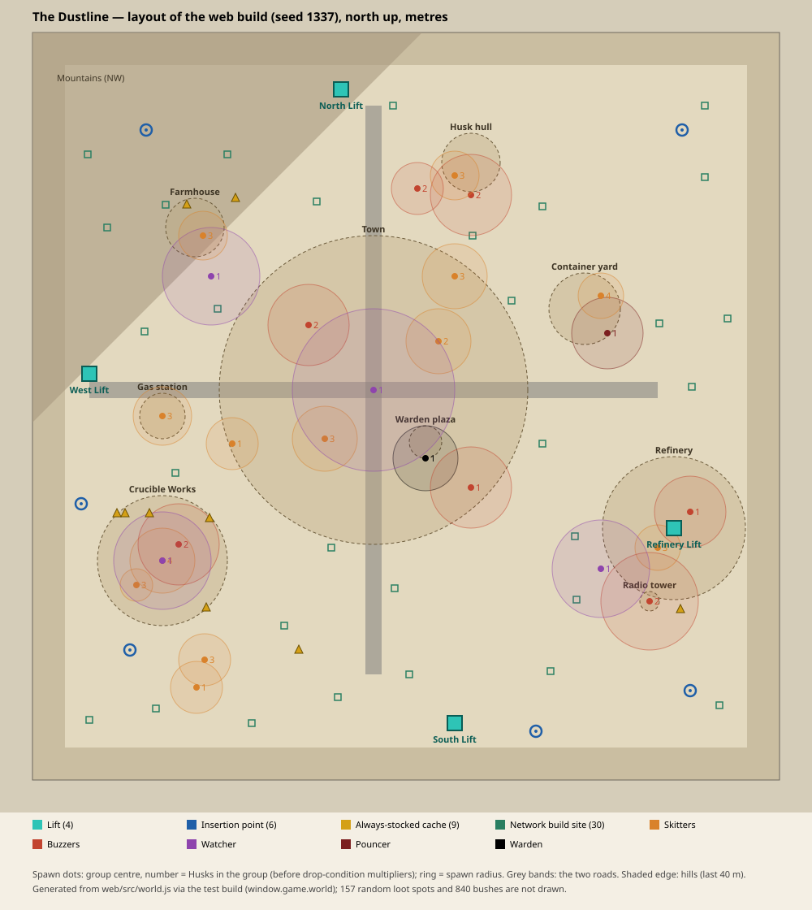

# Level: The Dustline

> **Reverse-documented from implementation** — generated by `/reverse-document`
> from `web/src/world.js` on 2026-10-30, at commit `bc456a6`.
> This records what the code **does**; intent marked `INTENT UNKNOWN` below was
> inferred, not confirmed by the author. Where this document and the code
> disagree, do not assume the document is the requirement.
> Counts and positions were read from the running web build (`window.game.world`
> in the test build), not estimated from the source. Calls marked `DESIGN CALL`
> were decided by the owner on 2026-10-30 for the Godot port.



## Quick Reference

- **Area/Region**: Topside, above the Patron's Sanctuary: a ruined town on a crossroads with industry, farmland and a Husk factory around it
- **Type**: Mixed (extraction raid: exploration, looting, combat by choice)
- **Estimated Play Time**: Up to 20 minutes per raid (`RAID_SECONDS` 1200, `raid-loop.md`)
- **Difficulty**: Set by drop condition and by the Husk Network, not by the map (`raid-loop.md` §3.2, `husk-network.md`)
- **Prerequisite**: Deploy from the Sanctuary lift (`sanctuary-hub.md`)
- **Status**: Final in the web build; **Concept** for the Godot port

**DESIGN CALL — how it is built in Godot.** The web map is generated by code
from a fixed seed (`makeRng(1337)`), so its layout never changes between raids.
In the Godot port it is **authored in the editor**, with Blender models, using
this document and the layout drawing as the blueprint. What changes per raid
(which containers are filled and what is in them, Husk spawn positions within
their radius, Network structures, the insertion point) stays in code.

**DESIGN CALL — fidelity.** Keep the layout: map size, landmark positions, the
two roads, lifts, insertion points, Husk spawn groups, loot-spot counts and
pools, Network build sites, and the cover rules. Buildings, props and terrain
detail are free to change in the art pass.

## Narrative Context

- **Story Moment**: Every raid. The Dustline is the only topside map.
- **Narrative Purpose**: Shows a world after the Husks came: a town left to
  decay, survivors' camps, and the Crucible AI's factory still building Husks.
- **Emotional Target**: Tension and greed: something worth taking in every
  direction, and a clock and Husks that make every detour a risk.
- **Lore Discoveries**: Network notices (curved billboards along the main roads
  "in the Network's voice"), the crashed Husk hull, Crucible Works' four
  part-making halls, raider camps and survivor shacks, the Field Bulletin's
  world (`home.js`). No written lore items exist. `INTENT UNKNOWN` whether more
  environmental story was planned.

## Layout

### Overview Map

See `dustline-layout.svg` (north up, metres, drawn from the web build's data).
Coordinates below are web-build world units (1 = 1 m; `x` east, `z` south, so
north is negative `z`).

- **Size**: 460 m × 460 m (`MAP_HALF` 230). Invisible walls at the border; the
  ground rises into hills over the last 40 m so the edge feels closed.
- **Terrain**: gentle noise hills, flattened around the town (radius ~95 m from
  (-20, -10)) and along the roads; a mountain range rises towards the
  north-west corner, eased round the farmhouse and the north-west drop point.
  Distant mountains form the horizon.
- **Roads**: two crossing roads through the town: east–west along z = -10
  (x -195 to 155) and north–south along x = -20 (z -185 to 165). Worn dirt
  trails run between places and fade out at their ends.

### Critical Path

There is no fixed route; the raid is open. The required path is only:

1. The raider starts at one of **six insertion points** (random each raid),
   all near the map edge, facing the map centre.
2. They loot and fight (or avoid fights) wherever they choose.
3. They reach one of **four lifts**, call it (20 s, the call draws Husks), and
   extract once the doors open (25 s window), before the 20-minute clock ends.

| Lift | Position | Notes |
|---|---|---|
| North Lift | (-40, -195) | North edge, near the crashed hull |
| West Lift | (-195, -20) | West end of the east–west road, past the gas station; Crucible Works lies south of it |
| South Lift | (30, 195) | South edge |
| Refinery Lift | (165, 75) | Inside the oil refinery |

Each lift: a 9 × 9 m concrete pad, a cabin of three walls and a roof open
towards the map centre, a call panel, doors, a lamp on a mast, and a light
beam that shows while it is called or open. Lifts show as a cyan ▲ on the
compass and map.

| Insertion point | Position |
|---|---|
| North-west | (-160, -170) |
| North-east | (170, -170) |
| West | (-200, 60) |
| South-west | (-170, 150) |
| South | (80, 200) |
| South-east | (175, 175) |

Lifts and insertion points are kept clear: nothing else is placed within 9 m
of them.

### Optional Paths

The whole map is optional ground. Routes are shaped by the roads (fast, open,
exposed), the trails, the hills and the NW mountains (slow, high ground), and
by bush cover (three sizes; see Points of Interest).

| Path | Access Requirement | Reward | Discovery Hint |
|------|-------------------|--------|---------------|
| Roads | None | Fastest crossing; cars to loot | Visible from every insertion |
| Through Crucible Works | Breaches where the outer wall has fallen; gates east and north | Dense loot, survivor caches | Watchtowers and shacks on the wall |
| Over the NW mountains | Climb | Avoids the town | Horizon silhouette |

### Points of Interest

| Location | Centre | Type | Description | Purpose |
|----------|--------|------|-------------|---------|
| Town | (-20, -10), ~95 m | Hub area | Ruined blocks along both roads: cracked, stained buildings, boarded windows, fallen roofs, rubble; an overturned bus at the crossroads, jersey barriers, street lamps, street signs | Most loot spots; most Husks; the Watcher's beat |
| Warden plaza | (12, 22) | Boss arena | A fountain ring and broken statues in an open square kept clear of buildings (20 m) | The Warden's guard post |
| Container yard | (110, -60) | Combat / loot | Shipping containers and a gantry crane, east of town | Pouncer and Skitters |
| Gas station | (-150, 6) | Loot | Cracked forecourt, sagging canopy, two pump islands, price sign, shop, a car at the pumps | West road stop before the West Lift |
| Farmhouse and fields | (-130, -110) | Loot | Two buildings, fences and fields under the mountains | Watcher and Skitters |
| Crashed Husk hull | (40, -150) | Landmark / combat | A huge ring-shaped hull north of town | Buzzers and Skitters |
| Oil refinery | (165, 75), ~44 m | Extraction / combat | Tanks, columns, a flare stack, pumpjacks, big trucks, oil barrels round the Refinery Lift | Lift under guard |
| Radio tower | (150, 120) | Landmark | A 36 m rusted tower on the south-east hill | Navigation; Buzzers and a Watcher nearby |
| Crucible Works | (-150, 95), ~80 × 70 m | Combat / loot | The Crucible AI's walled factory: Casting Hall, Optics Lab, Actuator Works, Core Assembly; a yard with a gantry crane, part piles and conveyors; a wall of 5 m segments, partly fallen; survivors' shacks, towers, shanties and sandbag nests on the standing wall, each with a cache | Densest Husk area; always-stocked caches |
| Raider camps | Scattered, ≥100 m from town | Loot | A sloped tarp over a cache (always stocked), gas cans, tyres, carts, sometimes a broken-down car | Safe-ish loot away from the town |
| Husk probes | Scattered, ≥90 m from town | Loot / combat | Half-buried probe pods with Husk pods beside them | Husk loot; sometimes a small Husk group |
| Power pylons | Across the map | Landmark | Pylons with cables | Navigation |
| Network build sites | 30 sites | Dynamic | Open ground where the Husk Network builds Bulwarks or Cradles between raids (`husk-network.md`) | The map changes with the raider's history |

**Cover.** 840 bushes in three sizes: low scrub hides a crouched raider;
shrubs and thickets hide a standing one. Raiders walk and shoot through them;
Husks cannot see through them beyond 3 m (`husk-ai.md` §3.3). Boulders,
trees (conifers, broadleafs, dead snags), rubble heaps and junk add hard cover
and texture.

## Encounters

### Combat Encounters

Husks spawn in **26 groups, 54 Husks** before drop-condition multipliers
(Night Raid ×1.35). Neutral Husks (Skitters, Buzzers, Watchers) only fight when
provoked or crowded; Pouncers and the Warden attack on sight (`husk-ai.md`).
Reinforcements arrive every 50 s at a group more than 70 m away (never a Pouncer
or the Warden), and every lift call adds 3 Husks (`raid-loop.md` §3.3).

| ID | Position | Enemy Composition | Arena Notes |
|----|----------|------------------|-------------|
| E-town | Town, 6 groups | 8 Skitters, 3 Buzzers in 2 groups + 1, 1 Watcher (50 m beat) | Streets, ruins, many sightlines; roads exposed |
| E-warden | Warden plaza (12, 32) | 1 Warden | Open square with a fountain ring; ruins round it |
| E-yard | Container yard | 1 Pouncer, 4 Skitters | Container stacks; the Pouncer's slam needs room |
| E-gas | Gas station | 3 Skitters | Forecourt, canopy |
| E-farm | Farmhouse (-120, -80) | 1 Watcher, 3 Skitters | Open fields; mountains behind |
| E-hull | Crashed hull | 2 Buzzers, 3 Skitters (a probe group of 2 Buzzers sits nearby at (7, -134)) | The ring hull blocks sight |
| E-refinery | Refinery | 3 Skitters, 1 Buzzer | Tanks and pipes; guards the Refinery Lift |
| E-tower | Radio tower hill | 2 Buzzers, 1 Watcher | High ground |
| E-works | Crucible Works | 7 Skitters in 2 groups, 2 Buzzers, 1 Watcher | Walled; breaches and gates are chokepoints |
| E-probes | 4 probe groups in the web build: (-129, 173), (7, -134), (-107, 23), (-124, 156) | 1–3 Skitters or Buzzers each (7 Husks in total) | Small, isolated |
| E-structures | Network sites (per raid) | Bulwark: a Watcher (+ a Buzzer if aggression > 0.5); Cradle: 2 Skitters | Built from the raider's history |

Exact centres, counts and radii are drawn in `dustline-layout.svg` and listed
by the web build's `world.enemySpawns`.

### Non-Combat Encounters

| ID | Position | Type | Description |
|----|----------|------|-------------|
| N-search | Every container | Looting | Hold E to search; items revealed one at a time (`economy.md`) |
| N-lift | Each lift | Extraction | Call, defend 20 s, enter within 25 s |
| N-wary | Anywhere | Stand-off | Neutral Husks watch and warn; backing off avoids the fight |

## Pacing Chart

```
Intensity
10 |                                         * (lift defence)
 8 |                         *  (town / Works / Warden)   *
 6 |               *    *   * *                         * *
 4 |      *  *   *  * *  *     *   *    *    *         *
 2 | *  *  ** **                 * *  *   * *  *     *
 0 |S------------------------------------------------------E
    [Edge: quiet] [Loot ring]  [Core: town/Works]  [Walk out] [Lift]
```

Insertion points sit at the quiet edge. Loot density and Husk density rise
towards the town and Crucible Works; the raider chooses how deep to go. Every
lift sits at the edge again, and calling it is the last spike. The clock and
the 50 s reinforcements push pace up over the raid.

## Audio Direction

| Zone/Moment | Music Track | Ambience | Key SFX |
|-------------|------------|----------|---------|
| Topside, any | None (no music in the web build) | Wind that picks up and dies down over a minute or two | Footsteps, Husk chirps |
| Husk warning | — | — | Chirp and eye flare |
| Lift called | — | — | Alarm, then lift sound |
| Combat | — | — | Gunfire by weapon shape, hits, explosions, shield hits/breaks |

All sound is synthesized (WebAudio). `INTENT UNKNOWN` whether topside music is wanted.

## Visual Direction

- **Lighting**: By drop condition (`raid-loop.md` §3.2, `raid_conditions.json` visuals):
  Golden Hour (warm low sun, dusty fog), Night Raid (moonlight, headlamp,
  dark blue fog), Dust Storm (thick orange-brown fog, short sight).
- **Color Palette**: Dust, rust and weathered concrete; cyan for lifts and
  Network tech; Husk eyes as the alert colour (yellow → orange → red by state).
- **Mood Board References**: Ruined, weathered: water stains, cracks, moss low
  on walls, rust, burnt-out cars, boarded windows (from the web build's
  materials and comments).
- **Landmarks**: The radio tower (SE), the flare stack (refinery), the crashed
  hull (N), Crucible Works' walls and crane (SW), the NW mountains, pylons;
  lift beams when lifts are active.
- **Sight Lines**: The roads give long views across town; the hull, the
  Works' walls and the containers break sight. Fog, not draw distance, limits
  what can be seen (`settings.md` §3.2).

## Collectibles and Secrets

Loot only; there are no collectibles or secrets.

**Loot spots.** 226 spots in the web build:

| Kind | Spots | Rule |
|---|---|---|
| Random spots | 157 | Each raid each is filled with 60% chance (`CONTAINER_FILL`), with a container type picked from the spot's pool |
| Always stocked | 9 | Camp caches and survivor shacks; filled every raid |
| Cradle pods | 60 (2 per build site) | Filled only where the Network has built a Cradle this raid |

Pools of the random and always-stocked spots (number of spots per pool): mixed
building pool *crate, locker, medical, weapon case* (72); *crate, locker,
medical* (19); car trunks (29); *crate, weapon case, Husk pod, locker* (10);
*Husk pod, Husk pod, crate* at probes (6); *crate, weapon case* (6); *Husk
pod* (4); 13 smaller pools of 1–4 spots each. Contents roll from the loot
tables in `economy.md`; the gold orb over a container shows only while it
holds something.

**Network build sites.** 30 sites, at least 38 m apart, more than 70 m from
the town centre, off the roads, and clear of lifts, insertion points, the
refinery yard and the Works.

## Technical Notes

- **Estimated Object Count**: Static geometry merged per material in the web
  build; 840 bushes; instanced grass (2,500–9,000 blades by preset) and ferns
  that follow the raider. Building and prop counts not measured.
- **Streaming Zones**: None; the whole map is loaded. Godot: decide in the
  graybox whether the map needs visibility ranges or occlusion per area
  (town, Works, refinery).
- **Performance Concerns**: Grass and foliage, the town's density, many
  lights at night. Budget 60 fps / 16.6 ms (ADR-0004) on both renderers.
- **Required Systems**: Raid loop, Husk AI and Network, economy (containers),
  player movement and combat, cover (sight blocking), foliage and wind,
  drop-condition lighting, settings.

**Port notes.**
- Placement rules the generator enforced become authoring rules: nothing
  within 9 m of a lift or insertion point; the refinery yard (44 m) and the
  Works (80 × 70 m) keep their own contents; containers at least 1.6 m apart.
- Positions of the random scatter (probes, camps, boulders, trees, bushes)
  came from the seed; in Godot they are placed by hand, keeping the counts
  and the "≥ 90/100 m from town" rules.
- Sight blocking by bushes needs its own data (the web build uses a grid of
  bush spheres, `sightCover`); Godot can use collision layers that Husk sight
  rays test but movement and bullets ignore.

## Acceptance Criteria (port)

- [ ] The map is 460 × 460 m with closed edges, hills at the border and mountains to the north-west.
- [ ] Each landmark, lift and insertion point is within 5 m of its position in this document.
- [ ] Two crossing roads follow the lines above.
- [ ] 26 Husk spawn groups with the listed compositions; 54 Husks before multipliers.
- [ ] 157 random loot spots with the listed pools, 9 always-stocked caches, 30 Network build sites with 2 pod spots each.
- [ ] Nothing is placed within 9 m of a lift or insertion point.
- [ ] Bushes hide a raider from Husks beyond 3 m (low scrub only when crouched); raiders can walk and shoot through them.
- [ ] A raider can walk from every insertion point to every lift.
- [ ] Graybox screenshot of each Point of Interest in `production/qa/evidence/` before the art pass.

## Open Questions and Follow-Up Work

- `INTENT UNKNOWN`: more environmental story (lore items) beyond notices and set dressing.
- `INTENT UNKNOWN`: topside music.
- Bush, tree and rock counts per area are not broken down; measure when grayboxing.
- Whether a fresh layout per raid was ever wanted (the seed is fixed): the owner chose a fixed, authored map.
